

# PTCG AI Battle Challenge

### KINGKAZMAX · 宝可梦卡牌 AI · 策略、搜索与实验复盘

[比赛官网](https://ptcg-abc.pokemon.co.jp/) · [Simulation 赛道](https://www.kaggle.com/competitions/pokemon-tcg-ai-battle) · [Strategy 赛道](https://www.kaggle.com/competitions/pokemon-tcg-ai-battle-challenge-strategy) · [Figma 图文档案](https://www.figma.com/design/UpPXmCgS3JXRhhwksWq8xq?node-id=2-2)

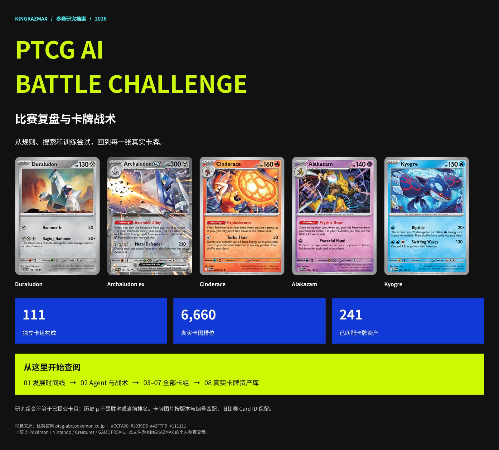

**111 套研究卡组 · 241 张独立卡牌 · 6,660 个逐张卡图槽位 · 12 页 Figma 档案**

## 新增：冠军与 Top 10 图文方案档案

已核实 **Simulation 最终前十名**与 **Strategy 官方获奖前八名**。冠军 Luca 同时获得两赛道第一；两榜分别列出。核实日期：2026-10-15。

[打开完整图文研究档案](report/portfolio/2026-10-15/top10/README.md) · [Figma 冠军与双榜](https://www.figma.com/design/UpPXmCgS3JXRhhwksWq8xq?node-id=27-2) · [十队完整原文与83张原图入口](report/portfolio/2026-10-15/top10/sources.json)

| Simulation | 团队 | 最终分数 | Strategy | 方案与核心牌组 |
|---:|---|---:|---:|---|
| 1 | [Luca](report/portfolio/2026-10-15/top10/README.md#team-1) | 1398.2 | 1 | Dragapult ex ×2；Hydrapple ex 候选 |
| 2 | [palsystem](report/portfolio/2026-10-15/top10/README.md#team-2) | 1297.8 | 3 | Crustle / Mega Kangaskhan ex |
| 3 | [Unown Gradiant](report/portfolio/2026-10-15/top10/README.md#team-3) | 1280.5 | 2 | Hydrapple ex；Crustle |
| 4 | [flg](report/portfolio/2026-10-15/top10/README.md#team-4) | 1266.1 | 4 | Dragapult ex / Crushing Hammer |
| 5 | [Petit Canard](report/portfolio/2026-10-15/top10/README.md#team-5) | 1257.3 | 8 | Slowking / Mega Kangaskhan ex |
| 6 | [KawattaTaido](report/portfolio/2026-10-15/top10/README.md#team-6) | 1229.5 | 6 | Slowking；Dragapult ex / Dusknoir |
| 7 | [LumenLiquidity](report/portfolio/2026-10-15/top10/README.md#team-7) | 1226.6 | 5 | Dragapult ex / Blaziken ex |
| 8 | [やる気元気ミワハルキ](report/portfolio/2026-10-15/top10/README.md#team-8) | 1214.2 | 7 | Dragapult ex / Moltres |
| 9 | [Rmy](report/portfolio/2026-10-15/top10/README.md#team-9) | 1200.0 | — | Teal Mask Ogerpon ex / Hydrapple ex |
| 10 | [Azat Akhtyamov](report/portfolio/2026-10-15/top10/README.md#team-10) | 1195.3 | — | Dragapult ex |

冠军重点：**2.24M Transformer、四阶段 PPO、原型平衡采样、对战矩阵选牌与固定牌组专家**。档案包含十队逐队架构、训练、战术、实验限制、原文 / 原图与公开代码状态，以及冠军两份最终 Dragapult 提交和一份 Hydrapple 备选的精确60张数量表。

<strong>展开冠军与双榜图文总览</strong>

这是他人公开方案的署名研究档案；我的参赛经历与结果继续列在下方。未公开的代码和权重不会用相似项目代替。十篇报告页面均声明MIT，阅读副本保留原作者、原图链接与许可；卡图权利仍归原权利人。

这是我参与 **PTCG AI Battle Challenge** 的项目工作区与研究档案。项目围绕一个问题展开：在看不到对手手牌和牌库顺序的宝可梦卡牌对局中，怎样让 Agent 稳定地返回合法动作，再通过规则、搜索、牌组协同和真实对局评测改善决策？

我做过规则与浅搜索策略、官方及社区 pilot 的适配、合法动作保护、部署打包、真实 field 评测，以及 PPO、蒸馏、RL + MCTS 和牌组搜索等训练尝试。这里同时记录有效结果、失败实验与来源，方便回看每条路线做了什么。

> 档案整理日期：**2026-10-15**。下文 μ 是标明版本的历史天梯读数；卡组档案也包含候选、对手提取与本机研究构成。具体提交以 [Agent catalog](eval/AGENT_CATALOG_FULL.md) 和历史回执为准。

## 查阅入口

| 想看什么 | 从这里开始 |
|---|---|
| 完整图文、卡图与战术排版 | [Figma：PTCG 比赛复盘与卡牌战术](https://www.figma.com/design/UpPXmCgS3JXRhhwksWq8xq?node-id=2-2) |
| 111 套牌组，逐张查看与搜索 | [下载 HTML 卡组查看器](report/portfolio/2026-10-15/index.html)；下载后用浏览器打开，GitHub 文件页不执行 HTML |
| 每张卡的 ID、版本、数量与来源 | [decks.json](report/portfolio/2026-10-15/decks.json) · [真实卡图来源与映射](report/portfolio/2026-10-15/card_art_sources.json) |
| 我的开发过程与失败结果 | [项目复盘](report/portfolio/2026-10-15/README.md) · [HISTORY](report/portfolio/2026-10-15/HISTORY.md) |
| 每个提交的策略、卡组与成绩 | [完整 Agent catalog](eval/AGENT_CATALOG_FULL.md) · [历史成绩记录](report/LADDER_BEST_SO_FAR.md) |
| 继续开发的当前状态 | [STATE](STATE.md) → [RULINGS](RULINGS.md) → [ROADMAP](ROADMAP.md) |

## 真实卡牌封面与核心组合

| 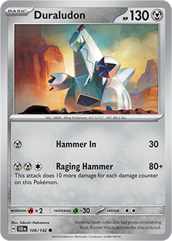 | 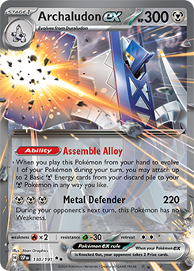 | 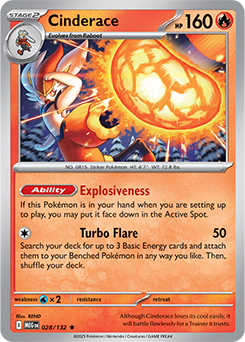 | 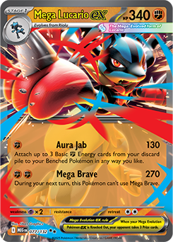 |  | 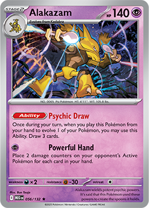 | 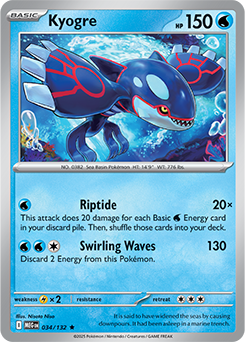 |
|:---:|:---:|:---:|:---:|:---:|:---:|:---:|
| Duraludon | Archaludon ex | Cinderace | Mega Lucario ex | Dragapult ex | Alakazam | Kyogre |

以上展示档案中使用的真实印刷卡图；同名卡按**系列、收藏编号和比赛 Card ID**识别。下列战术是对卡牌机制与历史实现的解释，具体效果由对应版本的规则与引擎处理。

### 1. Archaludon ex / Cinderace：钢系进化与能量循环

  

- **Duraludon → Archaludon ex**：进化形成主要战斗路线，围绕钢能量供给与进化时机组织场面。
- **Cinderace**：提供另一条能量铺场路线，与主要钢系路线共同考虑手牌、弃牌区和后备资源。
- **Agent 侧重点**：起手展开、进化、能量分配、替补安全、换位和终结对局；R7 bench guard 针对空后备区导致的失利补充保护。
- **历史归属**：社区 Archaludon v5 的适配与保护修复。历史 ref **54083197** 读数 **μ1196.1**，档案另记 peak **1224.2**；保留上游来源，不能把它算作本人从零训练的模型。

### 2. Mega Lucario ex / Hariyama：规则与搜索基线

围绕格斗系主攻与场面资源建立规则优先级，再尝试用搜索比较合法候选动作。该路线用于观察“决策方式”变化能否带来真实对局收益。

| 历史版本 | 历史 μ | 复盘结论 |
|---|---:|---|
| SearchScorer × Lucario | 660.5 | catalog 中最好 home-grown 逻辑基线 |
| basic MCTS | 651.3 | 该历史结果低于 SearchScorer |
| field RL + MCTS v5 | 580.6 | 较长训练没有超过同路线的规则 / 搜索基线 |

这些数字来自不同历史版本，应结合 catalog 的 brain × deck × training 与 ref 阅读。后续实验的出发点是先解释 pilot 的失败动作，再决定是否增加训练或搜索复杂度。

### 3. Dragapult ex：官方 sample 的接口适配与合法回退

Dragapult 路线适配官方 sample，整理 loader、包装和合法动作回退。历史 **ref53989933 / μ880.9**；该条目没有 RL 训练。研究时关注进化展开、伤害安排和残局选择，并通过实际引擎的 option mask 返回动作。

### 4. Alakazam：进化抽牌与手牌规模

以 Abra → Kadabra → Alakazam 的进化链、抽牌与手牌管理为核心，比较不同来源的候选牌组。远端 `ryotasueyoshi best5` 与本机 Javier Valenzuela 派生版本属于不同来源；卡图相同或核心相似，也要保留具体路径和构成。

### 5. Kyogre 与其他支线：能量密度、伤害与资源取舍

Kyogre 支线包含外能量密集样例与本机候选；Starmie / Froslass 等其他组合也保留在完整档案中。用卡组数量、资源结构与对局轨迹理解战术，比只看核心 Pokémon 名称更有帮助。

## 支援卡、道具与能量

主攻 Pokémon 之外，支援卡决定展开、手牌与资源流转。下面列出归档组合中出现的代表卡；每套牌实际采用多少张，见下方数量表或完整查看器。

|  | 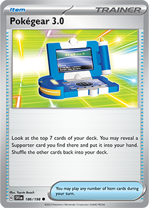 | 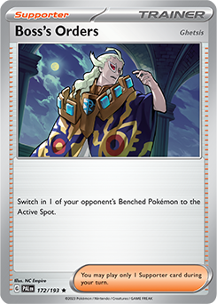 | 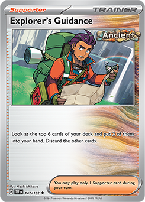 |
|:---:|:---:|:---:|:---:|
| **Ultra Ball** ID 1121 · SVI 196 | **Pokégear 3.0** ID 1122 · SVI 186 | **Boss’s Orders** ID 1182 · PAL 172 | **Explorer’s Guidance** ID 1185 · TEF 147 |

| 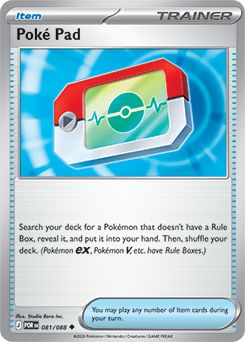 | 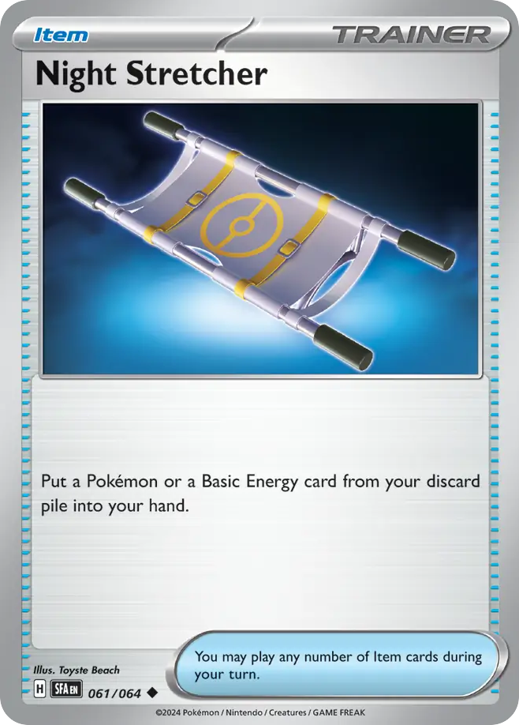 | 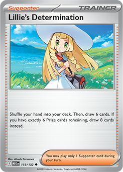 | 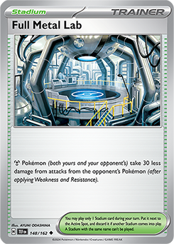 |
|:---:|:---:|:---:|:---:|
| **Poké Pad** ID 1152 · POR 81 | **Night Stretcher** ID 1097 · SFA 61 | **Lillie's Determination** ID 1227 · MEG 119 | **Full Metal Lab** ID 1244 · TEF 148 |

|  |  | 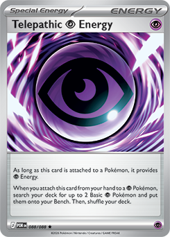 | 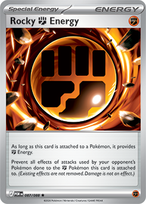 |
|:---:|:---:|:---:|:---:|
| **Basic {M} Energy** ID 8 · SVE 8 | **Basic {P} Energy** ID 5 · SVE 5 | **Telepath Psychic Energy** ID 19 · POR 88 | **Rock Fighting Energy** ID 20 · POR 87 |

**编号校正说明：**原比赛目录 ID 19 / 20 的收藏编号互换。这里根据卡名与效果，分别匹配 Telepathic Psychic Energy **POR 88** 和 Rocky Fighting Energy **POR 87** 的真实卡图；原比赛 Card ID、牌组数量和排列顺序保留。匹配记录见 [card_art_sources.json](report/portfolio/2026-10-15/card_art_sources.json)。

## 卡组如何排列、每张卡多少张

完整档案从 **381 份有效远端 CSV** 去重得到 **103 个远端构成**，再单独保留 **8 个本机构成**，合计 111 套。每套 60 张；Figma 保留源 CSV 的逐张输入顺序，同一张卡的多个副本各有独立槽位。这个顺序用于追溯输入，与实战洗牌或出牌次序分开理解。

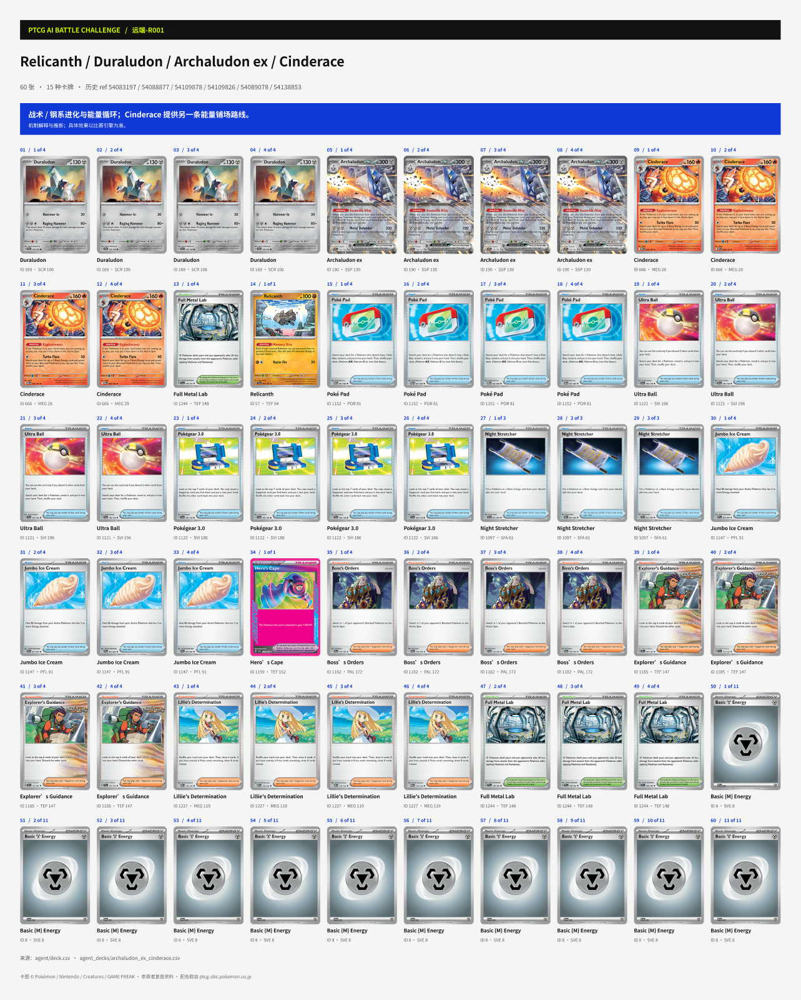

下面展开五套本机研究构成，查看精确数量。这些例子用于说明研究范围，提交状态另查历史证据。

<strong>本机-D01 · Makuhita / Hariyama / Lunatone / Solrock / Riolu / Mega Lucario ex · 60 张</strong>

斗能量资源与进化主攻手的候选配合。

[在 Figma 查看这套牌](https://www.figma.com/design/UpPXmCgS3JXRhhwksWq8xq?node-id=5-3215)

| Card ID | 卡牌 | 版本 / 实际卡图编号 | 张数 |
|---:|---|---|---:|
| 6 | Basic {F} Energy | SVE 6 | 14 |
| 673 | Makuhita | MEG 72 | 2 |
| 674 | Hariyama | MEG 73 | 2 |
| 675 | Lunatone | MEG 74 | 2 |
| 676 | Solrock | MEG 75 | 3 |
| 677 | Riolu | MEG 76 | 4 |
| 678 | Mega Lucario ex | MEG 77 | 4 |
| 1102 | Dusk Ball | SSP 175 | 4 |
| 1123 | Switch | SVI 194 | 2 |
| 1141 | Premium Power Pro | MEG 124 | 4 |
| 1142 | Fighting Gong | MEG 116 | 4 |
| 1152 | Poké Pad | POR 81 | 2 |
| 1159 | Hero’s Cape | TEF 152 | 1 |
| 1182 | Boss’s Orders | PAL 172 | 3 |
| 1192 | Carmine | TWM 145 | 4 |
| 1227 | Lillie's Determination | MEG 119 | 4 |
| 1252 | Gravity Mountain | SSP 177 | 1 |
| | **合计** | | **60** |

来源：`deck.csv`、`data/raw/decks/lucario/deck.csv`、`data/raw/public_opponents/improved_probabilistic_v1/deck.csv`、`artifacts/submission-improved-safe-v1.tar.gz::deck.csv`

<strong>本机-D02 · Kyogre / Snover / Mega Abomasnow ex · 60 张</strong>

高水能量密度与弃牌资源的候选思路。

[在 Figma 查看这套牌](https://www.figma.com/design/UpPXmCgS3JXRhhwksWq8xq?node-id=5-3462)

| Card ID | 卡牌 | 版本 / 实际卡图编号 | 张数 |
|---:|---|---|---:|
| 3 | Basic {W} Energy | SVE 3 | 35 |
| 721 | Kyogre | MEG 34 | 2 |
| 722 | Snover | MEG 35 | 4 |
| 723 | Mega Abomasnow ex | MEG 36 | 4 |
| 1145 | Mega Signal | MEG 121 | 4 |
| 1158 | Maximum Belt | TEF 154 | 1 |
| 1205 | Cyrano | SSP 170 | 2 |
| 1227 | Lillie's Determination | MEG 119 | 4 |
| 1235 | Waitress | ASC 215 | 4 |
| | **合计** | | **60** |

来源：`submission/deck.csv`、`data/raw/sample_submission/deck.csv`、`data/raw/loop24_sample_main/deck.csv`、`artifacts/submission-baseline-v0.tar.gz::deck.csv`、`artifacts/submission-baseline-v1.tar.gz::deck.csv`、`artifacts/submission-baseline-v2.tar.gz::deck.csv`、`artifacts/submission-baseline-v3.tar.gz::deck.csv`、`artifacts/submission-baseline-v4.tar.gz::deck.csv`、`artifacts/submission-bc-v2-s20260730-step2000.tar.gz::deck.csv`、`artifacts/submission-deploy-parity-v5.tar.gz::deck.csv`

<strong>本机-D03 · Dunsparce / Dudunsparce / Dunsparce / Abra / Kadabra / Alakazam · 60 张</strong>

以进化抽牌与手牌规模为核心的候选思路。

[在 Figma 查看这套牌](https://www.figma.com/design/UpPXmCgS3JXRhhwksWq8xq?node-id=5-3709)

| Card ID | 卡牌 | 版本 / 实际卡图编号 | 张数 |
|---:|---|---|---:|
| 5 | Basic {P} Energy | SVE 5 | 2 |
| 19 | Telepath Psychic Energy | POR 88 | 4 |
| 65 | Dunsparce | TEF 128 | 2 |
| 66 | Dudunsparce | TEF 129 | 4 |
| 305 | Dunsparce | JTG 120 | 1 |
| 741 | Abra | MEG 54 | 4 |
| 742 | Kadabra | MEG 55 | 4 |
| 743 | Alakazam | MEG 56 | 4 |
| 1079 | Rare Candy | SVI 191 | 3 |
| 1081 | Enhanced Hammer | TWM 148 | 3 |
| 1086 | Buddy-Buddy Poffin | TEF 144 | 4 |
| 1097 | Night Stretcher | SFA 61 | 3 |
| 1129 | Sacred Ash | DRI 168 | 1 |
| 1152 | Poké Pad | POR 81 | 4 |
| 1182 | Boss’s Orders | PAL 172 | 3 |
| 1184 | Lana’s Aid | TWM 155 | 1 |
| 1197 | Xerosic’s Machinations | SFA 64 | 3 |
| 1225 | Hilda | WHT 84 | 4 |
| 1227 | Lillie's Determination | MEG 119 | 1 |
| 1231 | Dawn | PFL 87 | 4 |
| 1247 | Neutralization Zone | SFA 60 | 1 |
| | **合计** | | **60** |

来源：`data/raw/decks/alakazam/deck.csv`、`data/raw/public_opponents/alakazam_rising_tide_v21_v1/deck.csv`、`data/raw/loop23_kernel_output/alakazam_v21_script338590620/extracted/deck.csv`、`artifacts/submission-alakazam-safe-v1.tar.gz::deck.csv`

<strong>本机-D05 · Froslass / Munkidori / Marnie's Impidimp / Marnie's Morgrem / Marnie's Grimmsnarl ex / Snorunt · 60 张</strong>

暗能量加速、分散伤害与指示物管理的候选思路。

[在 Figma 查看这套牌](https://www.figma.com/design/UpPXmCgS3JXRhhwksWq8xq?node-id=5-4203)

| Card ID | 卡牌 | 版本 / 实际卡图编号 | 张数 |
|---:|---|---|---:|
| 7 | Basic {D} Energy | SVE 7 | 10 |
| 104 | Froslass | TWM 53 | 2 |
| 112 | Munkidori | TWM 95 | 4 |
| 646 | Marnie's Impidimp | DRI 134 | 4 |
| 647 | Marnie's Morgrem | DRI 135 | 3 |
| 648 | Marnie's Grimmsnarl ex | DRI 136 | 3 |
| 860 | Snorunt | ASC 46 | 2 |
| 1079 | Rare Candy | SVI 191 | 3 |
| 1080 | Unfair Stamp | TWM 165 | 1 |
| 1086 | Buddy-Buddy Poffin | TEF 144 | 4 |
| 1097 | Night Stretcher | SFA 61 | 3 |
| 1122 | Pokégear 3.0 | SVI 186 | 1 |
| 1137 | Tool Scrapper | WHT 85 | 1 |
| 1152 | Poké Pad | POR 81 | 4 |
| 1182 | Boss’s Orders | PAL 172 | 2 |
| 1219 | Team Rocket's Petrel | DRI 176 | 4 |
| 1227 | Lillie's Determination | MEG 119 | 4 |
| 1231 | Dawn | PFL 87 | 1 |
| 1259 | Spikemuth Gym | DRI 169 | 4 |
| | **合计** | | **60** |

来源：`data/raw/decks/grimmsnarl/deck.csv`

<strong>本机-D06 · Relicanth / Duraludon / Archaludon ex / Cinderace · 60 张</strong>

钢系进化与能量循环；Cinderace 提供另一条能量铺场路线。

[在 Figma 查看这套牌](https://www.figma.com/design/UpPXmCgS3JXRhhwksWq8xq?node-id=5-4450)

| Card ID | 卡牌 | 版本 / 实际卡图编号 | 张数 |
|---:|---|---|---:|
| 8 | Basic {M} Energy | SVE 8 | 11 |
| 57 | Relicanth | TEF 84 | 1 |
| 169 | Duraludon | SCR 106 | 4 |
| 190 | Archaludon ex | SSP 130 | 4 |
| 666 | Cinderace | MEG 28 | 4 |
| 1097 | Night Stretcher | SFA 61 | 3 |
| 1121 | Ultra Ball | SVI 196 | 4 |
| 1122 | Pokégear 3.0 | SVI 186 | 4 |
| 1147 | Jumbo Ice Cream | PFL 91 | 4 |
| 1152 | Poké Pad | POR 81 | 4 |
| 1159 | Hero’s Cape | TEF 152 | 1 |
| 1182 | Boss’s Orders | PAL 172 | 3 |
| 1185 | Explorer’s Guidance | TEF 147 | 4 |
| 1213 | Judge | SVI 176 | 1 |
| 1227 | Lillie's Determination | MEG 119 | 4 |
| 1244 | Full Metal Lab | TEF 148 | 4 |
| | **合计** | | **60** |

来源：`data/raw/public_opponents/meta_a_stable_v1/deck.csv`

## Agent 怎样做决策

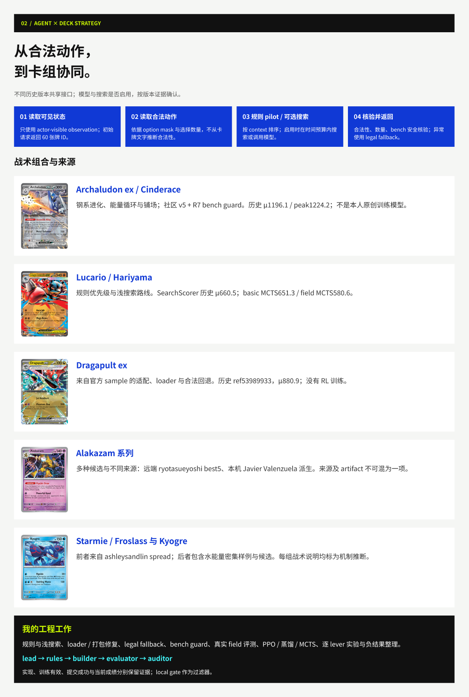

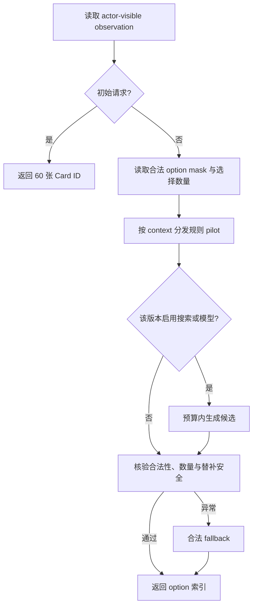

不同历史版本共用上述接口，搜索与模型是否启用按版本确认。工程重点包括：

1. **合法性与稳定性**：根据 simulator 给出的动作选项返回索引，处理选择数量、异常回退与空 bench 风险。
2. **规则策略与浅搜索**：把展开、进化、能量、换位和攻击等 context 映射到规则优先级；搜索只在时间预算内运行。
3. **评测闭环**：在真实 field 牌组与 public agents 上记录对手、种子、座位、版本、局数和置信区间，再与历史天梯证据对照。
4. **部署身份**：校验 loader、60 张牌组、确定性打包和历史提交 hash，区分“实现了”“测过”“提交过”与“只在设计中”。

开发协作中使用的 `lead → rules → builder → evaluator → auditor` 是工程分工；实际比赛动作由具体提交包中的对战 Agent 决定。belief / PIMC / ISMCTS 等设计项需要按版本证据判断完成情况。

## 我做过的工作与项目时间线

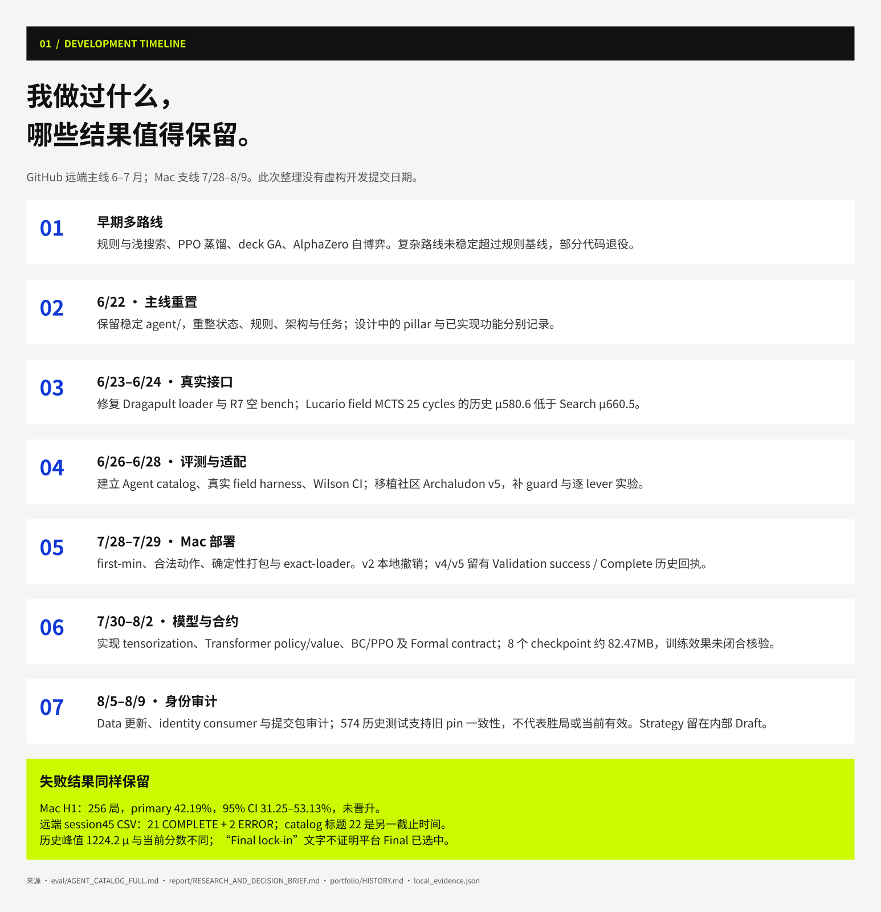

| 阶段 | 工作与产物 | 结果 / 下一步依据 |
|---|---|---|
| 早期探索 | 规则与浅搜索、PPO / 蒸馏、deck GA、AlphaZero 自博弈等尝试 | 复杂路线未稳定超过规则基线，保留失败与退役记录 |
| 6/22 主线重整 | 保留稳定 `agent/`，整理状态、规则、架构与任务 | 建立统一的决策与证据文档 |
| 6/23–6/24 接口修复 | Dragapult loader、R7 空 bench 保护、Lucario 搜索 / MCTS 比较 | 真实对局暴露的稳定性问题优先处理 |
| 6/26–6/28 评测与适配 | Agent catalog、真实 field harness、Wilson 区间、社区 Archaludon v5 适配与逐 lever 实验 | 记录上游归属与版本差异 |
| 7/28–7/29 Mac 部署 | first-min、合法动作、确定性打包、exact-loader 与 v4/v5 回执核对 | 有历史部署回执；v2 有撤销记录 |
| 7/30–8/2 本机模型 | tensorization、Transformer policy/value、BC/PPO 与 Formal contract | 8 个 checkpoint 约 82.47 MB；内部训练指标未完成闭合核验 |
| 8/5–8/9 身份审计 | Data 更新、identity consumer 与提交包一致性 | 保留旧 pin 一致性的历史测试；Strategy 留有内部 Draft |
| 10/15 档案整理 | 两套谱系、111 构成、真实卡图、Figma、GitHub 图文索引 | 用可追溯的版本和来源重新组织项目 |

### 成绩与失败结果一起保留

| 路线 | 历史记录 | 怎样理解 |
|---|---|---|
| Archaludon / Cinderace v5 + R7 | ref54083197，μ1196.1；档案 peak1224.2 | 社区规则适配与 bench guard，保留上游归属 |
| Dragapult v3 | ref53989933，μ880.9 | 官方 sample 适配、包装与回退，无 RL 训练 |
| SearchScorer × Lucario | ref53869254，μ660.5 | 自写规则 / 搜索路线的历史基线 |
| Lucario basic MCTS / field MCTS v5 | μ651.3 / 580.6 | 这些版本未超过规则 / 搜索基线 |
| Mac H1 pilot | 256 局；primary42.19%；95% CI31.25–53.13% | 未晋升；具体实验口径见 HISTORY |
| Mac v4 / v5 | 历史 Validation success / Complete 回执 | 可证明当时部署，当前 active / Final 身份另查平台证据 |

远端 GitHub 主线与 7/28–8/9 的 Mac 本机支线分别保留来源。本机原先没有 Git commit，checkpoint 存在与训练有效也分别记录。更完整的冲突口径、原始路径和证据 hash 见 [HISTORY](report/portfolio/2026-10-15/HISTORY.md) 与 [local_evidence.json](report/portfolio/2026-10-15/local_evidence.json)。

## 仓库结构与继续开发

| 目录 / 文档 | 用途 |
|---|---|
| `agent/` | 已交付的对战策略与各牌组 pilot；继续开发时保持稳定接口 |
| `scripts/` | 打包、上传门控、训练与数据获取工具 |
| `agent_decks/`、`field/` | 研究构成、真实 field 牌组与 public agents；完成程度以实际文件为准 |
| `eval/` | 评测脚本、Agent catalog 与历史结果 |
| `data/` | 规则、卡牌元数据与官方引擎相关资料 |
| `dist/` | 打包产物与候选提交相关文件 |
| `core/`、`episodes/`、`meta/`、`discovery/` | 架构规划与逐步建设模块，按 ARCHITECTURE / TASKS 核对实现状态 |
| `report/portfolio/2026-10-15/` | 中文复盘、HTML 查看器、卡组索引、Figma 清单与卡图出处 |
| `STATE.md` | 当前状态与单一下一步 |
| `RULINGS.md`、`AGENTS.md` | 实验规则、证据标准和协作约定 |
| `ROADMAP.md`、`ARCHITECTURE.md`、`TASKS.md` | 路线、架构与待办 |

从代码继续研究前，依次阅读 [STATE](STATE.md)、[Agent catalog](eval/AGENT_CATALOG_FULL.md)、[研究与决策简报](report/RESEARCH_AND_DECISION_BRIEF.md)、[RULINGS](RULINGS.md) 与 [AGENTS](AGENTS.md)。已有的退役实验与门控约束在这些文档中维护。

### 本地使用

图文 README 可直接在 GitHub 阅读。交互查看器需要下载 [index.html](report/portfolio/2026-10-15/index.html) 再用浏览器打开；文字与索引可离线查看，真实卡图加载需要网络。Figma 已嵌入卡图，可以从目录页浏览全部卡组与 241 张卡牌资产。

运行对战源码需要 **Python ≥3.11**、[requirements.txt](requirements.txt) 对应依赖，以及通过比赛官方渠道获取的 Competition Data / native engine。Kaggle 凭据保存在被 Git 忽略的配置位置。原生引擎、原始 replay、未审查权重和密钥不随图文展示包发布。实际启动、打包和提交使用对应模块文档与门控流程。

## 视觉来源与鸣谢

- 配色取自 [PTCG AI Battle Challenge 官网](https://ptcg-abc.pokemon.co.jp/)：荧光黄绿 **#CCFA00**、蓝 **#1039D5**、青 **#42F7FB**，配合黑白背景。
- 卡图按版本匹配，来源于 Pokémon 官方图片 CDN 及公开卡牌数据链接的图源；逐张 URL、SHA-256 与编号说明见 [来源清单](report/portfolio/2026-10-15/card_art_sources.json)。README 中的封面、图文板与代表卡图已随仓库保存。
- 官方 sample、社区 pilot 与第三方牌组保留来源；本人贡献集中在规则 / 搜索、适配、稳定性修复、评测、工程部署与实验复盘。
- 卡图 © Pokémon / Nintendo / Creatures / GAME FREAK。本仓库为 KINGKAZMAX 的个人参赛研究与复盘。
