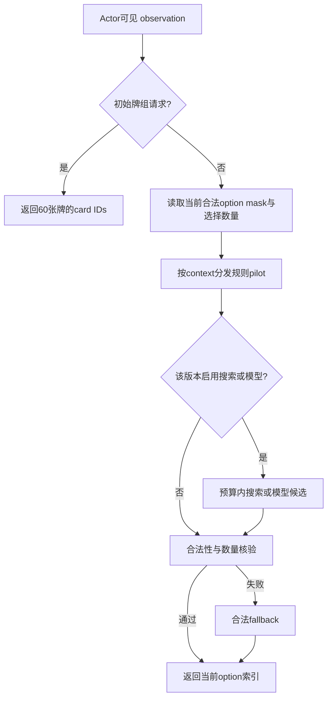

# PTCG：卡牌、Agent 与实验复盘

这是 KINGKAZMAX 的 Pokémon TCG AI Battle 项目回顾与卡组浏览入口，整理我做过的规则策略、搜索、训练尝试、部署修复、评测和失败决策。页面中的牌组、历史分数和原始出处分开标注；历史读数不代表当前排名，也不代表获奖。

[打开卡牌与组合战术](index.html) · [查看结构化卡组](decks.json) · [Figma用SVG素材](figma-svg/) · [开发过程与结果](HISTORY.md) · [归档与同步说明](SYNC.md)

## 我做过什么

- 写规则与浅搜索策略、合法动作回退、牌组读取和确定性提交包构建。
- 移植官方及社区牌组pilot，补充never-crash、空bench保护和逐项策略实验，保留上游署名。
- 做真实field对局、座位/批次分析、Wilson区间、部署与历史提交追踪；撤销有loader缺陷的候选。
- 实现并尝试PPO、蒸馏、RL+MCTS、牌组搜索；记录没有超过规则基线的结果。
- 用开发Agent协调规则核验、单写者构建、评测与独立审计；把“实现、测过、提交过、仅设计”分开。

## 两套工作谱系

| 工作谱系 | 核心资产 | 证据边界 |
|---|---|---|
| GitHub远端主线，6–7月 | `agent/`、`field/`、`eval/`、真实Git提交与比赛ref | 自写Search、外部pilot适配、PPO/MCTS历史结果；文档跨多个截止时间 |
| Mac本地支线，7/28–8/9 | `src/ptcg_agent/`、GOAL/LOOP、v4/v5精确hash回执、Formal contract | 原本零Git commit；8个checkpoint存在，但本次未核验内部训练指标；不能与远端成绩直接拼接 |

## 对战 Agent 流程

此图合并展示不同版本的共有接口；不表示每个历史提交同时启用了模型和搜索。belief/PIMC/ISMCTS等后续架构必须按版本确认，不能仅因在设计文档中出现就算完成。

## 历史结果摘要

| 路线 | 历史记录 | 归属与结论 |
|---|---|---|
| Archaludon/Cinderace v5+R7 | ref54083197，μ1196.1，历史peak1224.2 | 社区规则适配与bench guard；不是本人从零训练的模型或当前分数 |
| Dragapult v3 | ref53989933，μ880.9 | 官方sample+包装与guard，无RL训练 |
| SearchScorer × Lucario | ref53869254，μ660.5 | 远端catalog标为最好home-grown逻辑，依赖官方引擎 |
| Lucario basic MCTS / field MCTS v5 | μ651.3 /580.6 | 更长field训练未超过该历史规则/搜索基线 |
| Mac H1 pilot | 256局；预注册primary42.19%，95%区间31.25–53.13% | 未晋升；不是天梯胜率 |
| Mac v4/v5 | 历史平台Validation success /Complete回执 | 可证明部署，不能证明最新active/Final身份或收益 |

来源：[Agent catalog](https://github.com/KINGKAZMAX/kaggle_pokemon/blob/main/eval/AGENT_CATALOG_FULL.md)、[历史scoreboard](https://github.com/KINGKAZMAX/kaggle_pokemon/blob/main/report/LADDER_BEST_SO_FAR.md)。Mac证据见[脱敏文件与结论索引](local_evidence.json)，包含归档文件 SHA-256；原始回执留在本人的外盘存档。更多失败、口径冲突与训练边界见[HISTORY](HISTORY.md)。

## 使用与数据

此展示页可作为静态文件查看。运行对战源码还需要合法获取官方Competition Data与native engine，Python≥3.11；参见[原仓库依赖](https://github.com/KINGKAZMAX/kaggle_pokemon/blob/main/requirements.txt)和[运行文档](https://github.com/KINGKAZMAX/kaggle_pokemon/blob/main/README.md)。原生引擎、完整卡表、原始replay、密钥和未审查权重不随这个回顾包发布。
