# PTCG 冠军与 Top 10 图文研究档案

核实日期：**2026-10-15**。覆盖 **Simulation 最终 Top 10**、**Strategy 官方前八获奖名单**及十队的公开报告、图表和代码入口。内容归属原作者，本仓库作资料整理与方法比较；这是第一轮两赛道的结果，第二轮决赛结果需另查官方公告。

[官方 Simulation 最终榜](https://www.kaggle.com/competitions/pokemon-tcg-ai-battle/leaderboard) · [Strategy 官方获奖名单](https://www.kaggle.com/competitions/pokemon-tcg-ai-battle-challenge-strategy/hackathon-winners) · [Figma 图文总览](https://www.figma.com/design/UpPXmCgS3JXRhhwksWq8xq?node-id=27-2) · [结构化资料](top10.json)

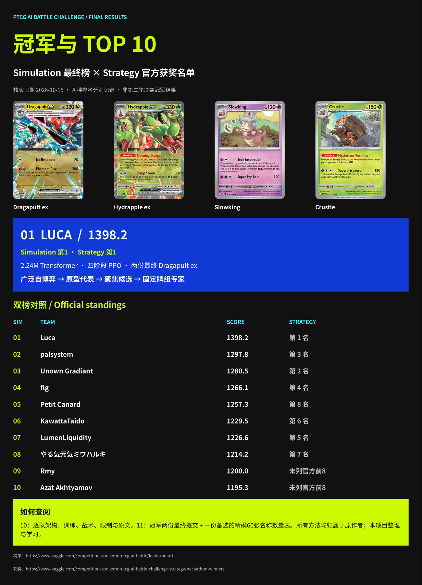

## 官方双榜对照

| Simulation | 团队 | 最终分数 | Strategy 获奖名次 | 核心路线 |
|---:|---|---:|---:|---|
| 1 | [Luca](#team-1) | 1398.2 | 1 | Dragapult ex ×2；Hydrapple ex 候选 |
| 2 | [palsystem](#team-2) | 1297.8 | 3 | Crustle / Mega Kangaskhan ex |
| 3 | [Unown Gradiant](#team-3) | 1280.5 | 2 | Hydrapple ex；Crustle |
| 4 | [flg](#team-4) | 1266.1 | 4 | Dragapult ex / Crushing Hammer |
| 5 | [Petit Canard](#team-5) | 1257.3 | 8 | Slowking / Mega Kangaskhan ex |
| 6 | [KawattaTaido](#team-6) | 1229.5 | 6 | Slowking；Dragapult ex / Dusknoir |
| 7 | [LumenLiquidity](#team-7) | 1226.6 | 5 | Dragapult ex / Blaziken ex |
| 8 | [やる気元気ミワハルキ](#team-8) | 1214.2 | 7 | Dragapult ex / Moltres |
| 9 | [Rmy](#team-9) | 1200.0 | 未列官方前8 | Teal Mask Ogerpon ex / Hydrapple ex |
| 10 | [Azat Akhtyamov](#team-10) | 1195.3 | 未列官方前8 | Dragapult ex |

分数直接取官方最终榜，不使用搜索引擎缓存的早期榜单。Strategy 是独立评审结果，不能从 Simulation 名次直接推导。

## 冠军：从通才到固定卡组专家

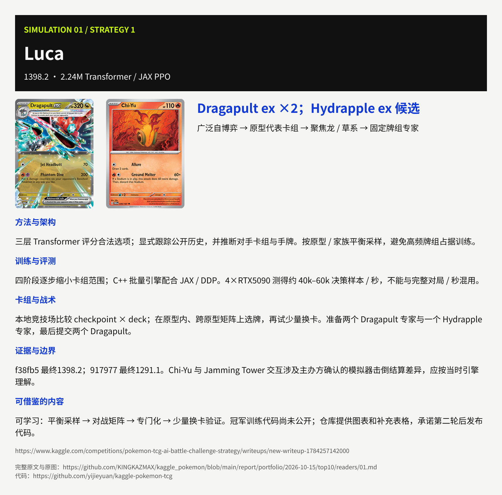

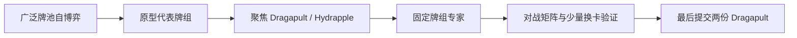

## 01. Luca · 1398.2

**2.24M Transformer / JAX PPO** · Dragapult ex ×2；Hydrapple ex 候选

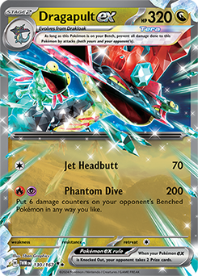 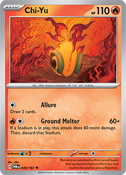

**训练流程：** 广泛自博弈 → 原型代表卡组 → 聚焦龙 / 草系 → 固定牌组专家

**架构与信息：** 三层 Transformer 评分合法选项；显式跟踪公开历史，并推断对手卡组与手牌。按原型 / 家族平衡采样，避免高频牌组占据训练。

**训练与评测：** 四阶段逐步缩小卡组范围；C++ 批量引擎配合 JAX / DDP。4×RTX5090 测得约 40k–60k 决策样本 / 秒，不能与完整对局 / 秒混用。

**卡组战术：** 本地竞技场比较 checkpoint × deck；在原型内、跨原型矩阵上选牌，再试少量换卡。准备两个 Dragapult 专家与一个 Hydrapple 专家，最后提交两个 Dragapult。

**验证与限制：** f38fb5 最终1398.2；917977 最终1291.1。Chi-Yu 与 Jamming Tower 交互涉及主办方确认的模拟器击倒结算差异，应按当时引擎理解。

**学习要点：** 可学习：平衡采样 → 对战矩阵 → 专门化 → 少量换卡验证。冠军训练代码尚未公开；仓库提供图表和补充表格，承诺第二轮后发布代码。

[作者原报告](https://www.kaggle.com/competitions/pokemon-tcg-ai-battle-challenge-strategy/writeups/new-writeup-1784257142000) · [完整原文与 23 张图表阅读副本](readers/01.md) · [作者项目仓库](https://github.com/yijieyuan/kaggle-pokemon-tcg)

作者 / 成员：[Luca](https://www.kaggle.com/yijiey)

## 02. palsystem · 1297.8

**2.4M policy / 双阶段 PPO** · Crustle / Mega Kangaskhan ex

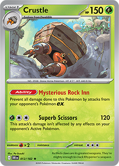 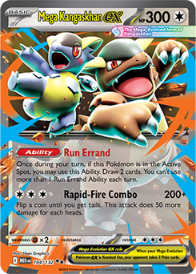

**训练流程：** 3,341 去重卡组 → 12B步通才 PPO → 针对头部选牌 → 4.2B步专家 PPO

**架构与信息：** 从随机权重训练通才，训练主线无模仿学习预热；Transformer 结合状态、卡组与合法选项。受限引擎探测提供动作后果和后续可用动作。

**训练与评测：** 公开回放构成3,341套卡组；Phase1约12B环境步，Phase2约4.2B步。训练 critic 可用额外隐信息，部署 actor 不接收它。

**卡组战术：** 用相同通才比较候选与领先队伍牌组，最终选 Crustle / Mega Kangaskhan。防御、抽牌与治疗争取拖空对手牌库；non-ex 攻击手是主要风险。

**验证与限制：** 提交使用 depth-3 选择步骤探测 + 后续检查，再 greedy actor 选择；这里深度是选择步骤，不是3个完整回合。未采用较慢且收益不稳定的 critic 重排 / beam search。

**学习要点：** 可学习：受限探测作为特征，与部署时的在线 MCTS 分开；本地胜率与公开胜率有偏差。报告未附可核实的团队代码仓库。

[作者原报告](https://www.kaggle.com/competitions/pokemon-tcg-ai-battle-challenge-strategy/writeups/new-writeup-1788449799640) · [完整原文与 5 张图表阅读副本](readers/02.md)

作者 / 成员：[ktr](https://www.kaggle.com/kcotton21)、[Ebi](https://www.kaggle.com/ebinan92)

## 03. Unown Gradiant · 1280.5

**4.4M pointer attention / PPO** · Hydrapple ex；Crustle

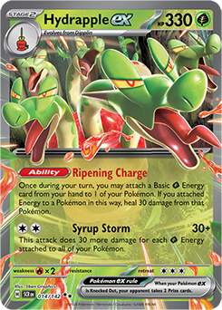 

**训练流程：** 约500卡组自博弈 → 6B步单策略 → 卡组对战矩阵 → 博弈式双卡组选择

**架构与信息：** 单一无递归记忆策略搭配外部信息 tracker；四层八头 pointer attention，逐个选择多选动作。卡牌文本嵌入经 PCA，与规则和状态特征结合。

**训练与评测：** 原生 C/CUDA PufferLib 提升训练吞吐；报告约6B步、8×3090、约四天。训练 oracle critic 使用隐信息，actor保持可见信息边界。

**卡组战术：** 同一策略估计 deck-vs-deck 矩阵，改变预期对手混合做敏感性检查。最终选择 Hydrapple 与 Crustle；LLM 提案经对局和审查后再加入牌池。

**验证与限制：** 报告暴露已知顶牌 tracker 缺口；MCTS 收益在更强模型上消失。最终部署 argmax policy；公开代码仓库含训练器、deck lab 与精确提交文件。

**学习要点：** 可学习：稳定通才 + 显式信息追踪 + 可检验选牌。报告约500套的训练口径与代码发布版616套牌池分别记录。

[作者原报告](https://www.kaggle.com/competitions/pokemon-tcg-ai-battle-challenge-strategy/writeups/team-unown-gradiant-solution-all-decks-on-hand) · [完整原文与 9 张图表阅读副本](readers/03.md) · [作者项目仓库](https://github.com/dipamc/kaggle-ptcg-ai-battle)

作者 / 成员：[Dipam Chakraborty](https://www.kaggle.com/dipamc77)

## 04. flg · 1266.1

**Transformer / 同步 PPO** · Dragapult ex / Crushing Hammer

 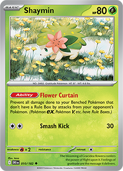

**训练流程：** 广泛牌池 → 补全381覆盖牌组 → 按预期环境调整 → Slowking 专项微调

**架构与信息：** 按实体聚合卡片、能量、工具与状态；确定性 tracker 携带已知顶牌、奖赏区与公开对手信息。STOP处理可选多选动作。

**训练与评测：** 同步自博弈 PPO；终局奖励、EMA与保留冠军约束漂移。报告四周、主要8×RTX5090，共16B样本，其中12B Dragapult、4B其他。

**卡组战术：** 覆盖牌组补充罕见机制；约1,000份Slowking回放的短BC教学帮助自博弈对手掌握顶牌连招，再训练专项策略，观察到对方公开Slowking组合后切换。

**验证与限制：** 最终两份均为Dragapult构成。四张Crushing Hammer延缓能量；损伤分布和干扰创造多奖赏回合。覆盖与训练分配的结论来自其特定实验。

**学习要点：** 可学习：先让对手真正会玩，再训练克制它；处理未知卡覆盖。报告未附团队代码发布链接，参数量未在已查正文中明确给出。

[作者原报告](https://www.kaggle.com/competitions/pokemon-tcg-ai-battle-challenge-strategy/writeups/new-writeup-1782463123738) · [完整原文与 8 张图表阅读副本](readers/04.md)

作者 / 成员：[flg](https://www.kaggle.com/ferdinandlimburg)

## 05. Petit Canard · 1257.3

**BC → League PPO → Gumbel search** · Slowking / Mega Kangaskhan ex

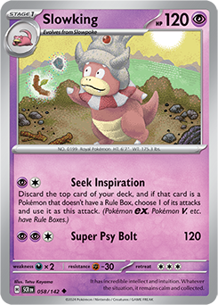 

**训练流程：** 模仿预热 → League PPO → 单牌组专家 → 对位专家 + 搜索

**架构与信息：** 显式恢复日志中遗漏的效果，并把进化潜力纳入特征；多选自回归。通才、牌组专家与十二类对位专家逐层训练。

**训练与评测：** 作者报告Slowking固定评测由47.6%至72.1%，对位专门化再约+3.5pp；搜索约+6.4pp。均为作者本地口径，不是公开榜通用胜率。

**卡组战术：** Slowking通过准备顶牌复制攻击；Codebreaking + Mega Kangaskhan抓到精确资源，优先提高展开一致性，权衡tech卡与启动资源。

**验证与限制：** Gumbel 搜索按隐信息重新设计：填补对手未知区，避免跨信息集机械取负价值，并处理按决策步数截断的偏差。

**学习要点：** 可学习：搜索针对编码缺失与具体致胜线；报告也指出通才对手偏弱与选牌过早。未附可核实团队代码仓库。

[作者原报告](https://www.kaggle.com/competitions/pokemon-tcg-ai-battle-challenge-strategy/writeups/new-writeup-1787069823045) · [完整原文与 5 张图表阅读副本](readers/05.md)

作者 / 成员：[Petit Canard](https://www.kaggle.com/petitcanard)

## 06. KawattaTaido · 1229.5

**0.73M Transformer / Bayesian belief** · Slowking；Dragapult ex / Dusknoir

 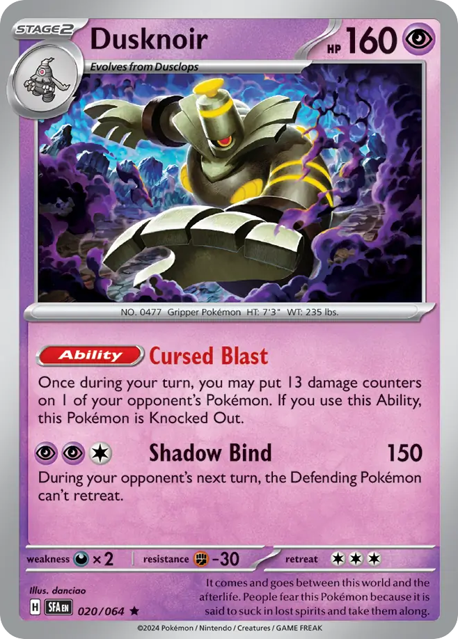

**训练流程：** 原型内自博弈 → 对位微调 → Bayesian隐区估计 → 按后验切换策略

**架构与信息：** 策略无回放模仿预热；回放用于牌组、环境统计和动作证据模型。先训练原型，再针对对手类别训练并按后验混合 / 切换策略。

**训练与评测：** 每张卡的预期隐藏副本数作为输入；贝叶斯原型后验与隐区质量流跟踪结合。伤害 / KO 特征显式计算，多阶段效果按实际选择顺序更新。

**卡组战术：** Slowking复制攻击与Dragapult / Dusknoir形成不同策略线；同一60张牌会按对手改变构建与资源分配，不能只凭卡组名推断打法。

**验证与限制：** 作者A/B报告对位切换约+12–14pp、隐区估计+4.9pp；另用小型AND/OR必胜搜索。作者也报告若干value lookahead方案无效。

**学习要点：** 可学习：把“知道什么”和“采取什么策略”共同设计；统计来自特定固定对手测试。未附可核实团队代码仓库。

[作者原报告](https://www.kaggle.com/competitions/pokemon-tcg-ai-battle-challenge-strategy/writeups/new-writeup-1787373273295) · [完整原文与 11 张图表阅读副本](readers/06.md)

作者 / 成员：[KawattaTaido](https://www.kaggle.com/kawattataido)

## 07. LumenLiquidity · 1226.6

**10.7M Transformer + GRU / League RL** · Dragapult ex / Blaziken ex

 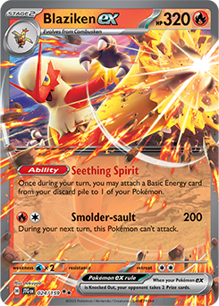

**训练流程：** 卡牌文本与效果编码 → 冻结对手联盟 → 训练克制主策略的对手 → greedy + 致胜检查

**架构与信息：** 编码卡牌文本、效果、属性与实时状态；GRU维持belief，pointer对合法动作打分。没有学习的卡牌ID专属参数。

**训练与评测：** 摘要称70+冻结对手，训练章节描述联盟扩展；使用V-trace / UPGO与PPO clipping。最初规则机器人预热，与后续放弃回放克隆分别记录。

**卡组战术：** Dragapult负责抽牌与伤害分布，Blaziken再附能量应对干扰与草系；Chi-Yu处理Crustle，Munkidori转伤，Lillie’s Clefairy提供额外对策。

**验证与限制：** 确定性致胜搜索覆盖policy，少量dominated-action masks去除明显无效选项。代码链接核实时返回404，不能视为已获得源码。

**学习要点：** 可学习：暴露模型缺失的战术量，用针对性对手逼出答案；精确60张名称数量表已从公开报告整理。

[作者原报告](https://www.kaggle.com/competitions/pokemon-tcg-ai-battle-challenge-strategy/writeups/7th-place-solution-for-the-ptcg-ai-battle-challeng) · [完整原文与 4 张图表阅读副本](readers/07.md) · [作者项目仓库](https://github.com/Z3rox-dev/pokemon-tcg-7th-place-transformer-agent)

作者 / 成员：[Giovanni Baldon](https://www.kaggle.com/giovannibaldon)、[Squapale](https://www.kaggle.com/pasqualemadd4loni)

## 08. やる気元気ミワハルキ · 1214.2

**3.23M Transformer / BC + PPO** · Dragapult ex / Moltres

 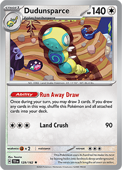

**训练流程：** BC学基本动作 → 273M局通才PPO → 固定对手评测 → 六类对位专家

**架构与信息：** 先模仿，再大规模GPU自博弈，最后结合固定对手评测和专家回放复盘训练对位专家。显式记录合法选项、能量缺口、效果状态与历史。

**训练与评测：** 报告通才阶段约273M完整对局；单位与其他队伍的环境步 / 决策样本不同。最终部署策略由通才与六类对位专家组成。

**卡组战术：** Dragapult伤害分配配合Risky Ruins / Munkidori；Crispin与Meowth保障供能，Dudunsparce持续抽牌，Moltres提供单奖赏火系反击。

**验证与限制：** 公开牌表总计19 Pokémon、32 Trainers、9 Energy。全表为报告图像，未把本人的相似Dragapult牌组冒充其提交。

**学习要点：** 可学习：GPU引擎提速与人类专家审查共同使用；报告未提供可核实团队代码发布仓库。

[作者原报告](https://www.kaggle.com/competitions/pokemon-tcg-ai-battle-challenge-strategy/writeups/8th-place-solution-yaruki-genki-miwa-haruki) · [完整原文与 14 张图表阅读副本](readers/08.md)

作者 / 成员：[Kohei](https://www.kaggle.com/confirm)、[masayoshi](https://www.kaggle.com/masayoshi64)、[tomo0608](https://www.kaggle.com/tomo0608)、[c-number](https://www.kaggle.com/cnumber)、[HARUKI MIWA](https://www.kaggle.com/harukimiwa)

## 09. Rmy · 1200.0

**7.8M Transformer / bounded probe PPO** · Teal Mask Ogerpon ex / Hydrapple ex

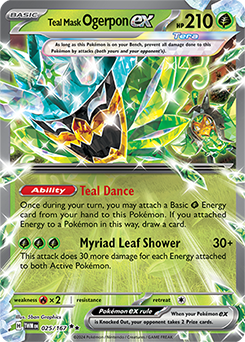 

**训练流程：** 回放 BC → value fine-tune → 大批量 PPO → NumPy部署 + 引擎特征

**架构与信息：** 64状态token、五层Transformer；每个候选交叉注意力读取状态，受限引擎探测生成28个后果特征。最多探测64候选，不等于在线MCTS。

**训练与评测：** BC → value训练 → PPO。oracle critic的对手手牌仅供训练，部署policy不接收。公开仓库提供代码、最终权重与中英报告。

**卡组战术：** Ogerpon抽牌附能量，Hydrapple加速并将全场草能量转成伤害，Meganium倍增基础草能量；后备位、进化线与能量去向需共同安排。

**验证与限制：** 两份最终提交同一牌表与模型。报告明确无在线MCTS；本地训练胜率与实战统计分开。精确60张名称数量表已整理。

**学习要点：** 可学习：用受限引擎探测降低学习机制成本，再训练资源排序；代码依赖原比赛运行时。

[作者原报告](https://www.kaggle.com/competitions/pokemon-tcg-ai-battle-challenge-strategy/writeups/new-writeup-1788435877208) · [完整原文与 4 张图表阅读副本](readers/09.md) · [作者项目仓库](https://github.com/YoInaOwO/pokemon-tcg-ai-battle-9th)

作者 / 成员：[yo](https://www.kaggle.com/mekory)

## 10. Azat Akhtyamov · 1195.3

**身份条件模仿 → 多阶段 PPO** · Dragapult ex

 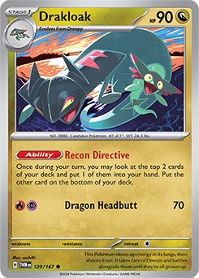

**训练流程：** 448提交身份模仿 → 锦标赛过滤回放 → 313→176牌池PPO → 固定Dragapult聚焦

**架构与信息：** 同一网络学习不同团队 / 提交风格，identity token在RL阶段关闭。卡牌、动作和效果嵌入从文本初始化，多选自回归。

**训练与评测：** 最终模仿集约9.9M决策，来自67队448份提交；四阶段PPO使用8×RTX5090，终局奖励与牌组突变扩大经验。

**卡组战术：** 用模仿代理锦标赛过滤数据，再用同策略牌组锦标赛缩小牌池。最后固定一方Dragapult，另一方从剩余牌池采样。

**验证与限制：** 作者最后固定评测中Dragapult为51/64胜，明确只是小样本开发池指标；不能写成79.7%公开榜胜率。

**学习要点：** 可学习：把回放来源身份当条件，筛选行为数据后再RL；报告未附可核实团队代码仓库。

[作者原报告](https://www.kaggle.com/competitions/pokemon-tcg-ai-battle-challenge-strategy/writeups/new-writeup-1787057147099) · [完整原文与 0 张图表阅读副本](readers/10.md)

作者 / 成员：[Azat Akhtyamov](https://www.kaggle.com/azakhtyamov)

## 冠军三份精确60张名称数量表

来自作者公开的 [decks.xlsx](https://github.com/yijieyuan/kaggle-pokemon-tcg/blob/main/strategy-track/supplements/decks.xlsx)。f38fb5 与 917977 为最后两份正式提交；f04db8 是备选。源表名称未唯一限定印刷版本时，不猜测 Card ID。这里按源表类别整理，不能视为原始输入顺序。

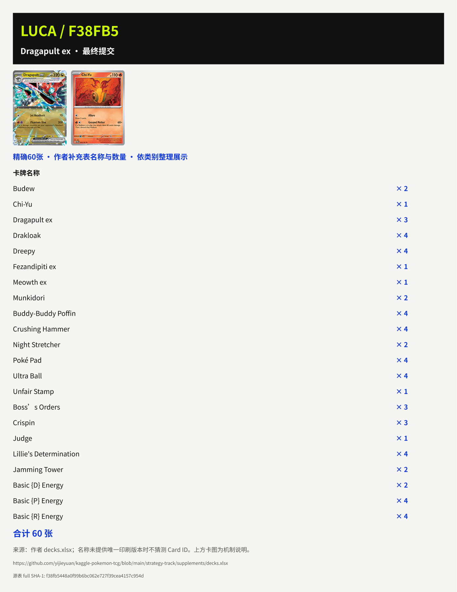

<strong>917977 · Dragapult ex · 最终提交</strong>

| 卡牌名称 | 张数 |
|---|---:|
| Budew | 2 |
| Dragapult ex | 3 |
| Drakloak | 4 |
| Dreepy | 4 |
| Fezandipiti ex | 1 |
| Meowth ex | 1 |
| Munkidori | 2 |
| Buddy-Buddy Poffin | 4 |
| Crushing Hammer | 4 |
| Night Stretcher | 2 |
| Poké Pad | 4 |
| Ultra Ball | 4 |
| Unfair Stamp | 1 |
| Boss’s Orders | 3 |
| Crispin | 3 |
| Judge | 2 |
| Lillie's Determination | 4 |
| Team Rocket's Watchtower | 2 |
| Basic {D} Energy | 2 |
| Basic {P} Energy | 4 |
| Basic {R} Energy | 4 |
| **合计** | **60** |

源表 SHA-1：`917977559267ec03102e990e471c91e99853763b`。

<strong>f38fb5 · Dragapult ex · 最终提交</strong>

| 卡牌名称 | 张数 |
|---|---:|
| Budew | 2 |
| Chi-Yu | 1 |
| Dragapult ex | 3 |
| Drakloak | 4 |
| Dreepy | 4 |
| Fezandipiti ex | 1 |
| Meowth ex | 1 |
| Munkidori | 2 |
| Buddy-Buddy Poffin | 4 |
| Crushing Hammer | 4 |
| Night Stretcher | 2 |
| Poké Pad | 4 |
| Ultra Ball | 4 |
| Unfair Stamp | 1 |
| Boss’s Orders | 3 |
| Crispin | 3 |
| Judge | 1 |
| Lillie's Determination | 4 |
| Jamming Tower | 2 |
| Basic {D} Energy | 2 |
| Basic {P} Energy | 4 |
| Basic {R} Energy | 4 |
| **合计** | **60** |

源表 SHA-1：`f38fb5448a0f99b6bc062e727f39cea4157c954d`。

<strong>f04db8 · Hydrapple ex · 最终候选，未入最后两份提交</strong>

| 卡牌名称 | 张数 |
|---|---:|
| Applin | 2 |
| Bayleef | 2 |
| Chikorita | 2 |
| Dipplin | 2 |
| Fezandipiti ex | 1 |
| Hydrapple ex | 2 |
| Meganium | 2 |
| Meowth ex | 2 |
| Tapu Bulu | 2 |
| Teal Mask Ogerpon ex | 4 |
| Bug Catching Set | 4 |
| Night Stretcher | 2 |
| Poké Pad | 2 |
| Ultra Ball | 4 |
| Unfair Stamp | 1 |
| Boss’s Orders | 2 |
| Dawn | 1 |
| Lana’s Aid | 1 |
| Lillie's Determination | 4 |
| Xerosic’s Machinations | 1 |
| Forest of Vitality | 4 |
| Basic {G} Energy | 13 |
| **合计** | **60** |

源表 SHA-1：`f04db8a22692a5c960874a086bb3feb6dc21b2c2`。

## 与我现有项目怎样对照

以下是整理者的学习方向，不是已实现或重现实验结论：

| 对照点 | Top10 公开经验 | 我现有档案的衔接 |
|---|---|---|
| 先保证可见信息完整 | tracker、已知顶牌、持续效果、belief | 从 loader / identity / 合法回退记录出发，逐项核查编码 |
| 让训练对手会玩 | 专家、覆盖牌组、冻结联盟、克制者 | 把真实 field 与版本证据作为评测基础，记录每个对手的 pilot |
| 区分选牌和选策略 | 同一pilot对战矩阵、原型平衡、对位专家 | 111套研究牌组继续保留来源，避免只比较卡组名 |
| 专门化需要对照 | 通才 → 牌组专家 → 对位专家 | 先做固定对手、种子和座位平衡的实验，再比较公开成绩 |
| 搜索的作用依实现而异 | 引擎探测特征、Gumbel、致胜证明、被弃用的MCTS | 不把搜索名称当收益证据，记录预算、收益与失败 |

## 公开程度与资料边界

十篇报告均已读取正文并核对页面 MIT 声明；完整阅读副本包含原图链接。冠军仓库当前提供图表和补充表，说明代码第二轮后发布。第3名和第9名代码仓库可访问；第7名报告链接返回404。其他队伍没有在已核实报告中附上团队代码发布仓库。未公开的权重、源码、完整牌表或对局数据不会用相似项目补齐。

[完整来源索引](sources.json) · [结构化双榜和方法](top10.json) · [图文同步元数据](figma_manifest.json)
